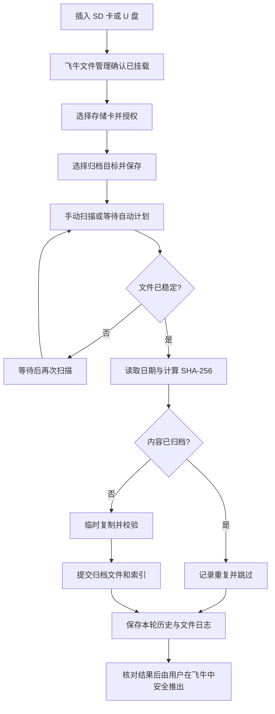

# 日常操作教程与流程

## 一次完整的素材归档

## 选择与授权

「选择文件夹」设置 NAS 内部归档目标，选好后需要保存配置。「选择存储卡」设置读取来源，通过检查后立即保存。默认不会删除或格式化来源，软件不会代替飞牛挂载或推出设备。

飞牛客户端内使用系统原生弹窗；独立浏览器会打开飞牛授权窗口。若被拦截，允许本次弹窗后重试。授权完成未回传时，回到 DIT 点击“刷新选择结果”。取消选择保留原配置。

## 手动与自动扫描

- **立即扫描一次**：立即尝试导入，不是仅列出文件。新发现文件仍需稳定观察。
- **自动导入**：开关开启并保存后才生效，默认关闭。
- **扫描间隔**：5–3600 秒，本轮结束后重新安排。手动扫描会取消旧计划，结束后按当前间隔重排。
- **稳定等待**：5–3600 秒。文件大小或修改标记发生变化会重新计时，不依赖相机日期与 NAS 日期的先后关系。
- 当前卡已完成且没有待稳定/失败时，会在其仍连接期间跳过重复自动处理。要再次完整检查请点击手动扫描；拔出后重新插入也会重新识别。

## 工作状态

“当前任务”显示正在检查的文件或等待数量。“上次扫描”和“下次扫描”固定使用东八区 UTC+8。运行中显示本轮结束后安排；关闭自动导入时明确显示未开启。

“待稳定”表示本轮没有复制这些文件；“失败”表示尝试中遇到错误，需要打开日志查看。扫描完成后处于待机属于正常状态，历史记录仍然保留。

## 分类设置

- 日期加类型：`年份/日期/RAW|JPG|VIDEO|OTHER/原文件名`。
- 日期混合：`年份/日期/原文件名`。
- 日期优先读取支持的拍摄元数据，解析不到回退文件修改时间。修改相机时间不会被应用自动修正；首次使用应核对实际分组。
- RAW 与同名 JPG 都会保留；同名不同内容使用冲突名称，避免覆盖。
- 内容去重索引会复用此前已归档的文件，改变目标目录不代表一定复制第二份。若需要多份独立副本，请使用备份工具，不要删除索引来试探。

## 查看每次同步了多少

进入 **导入历史**，查看每轮的开始时间、触发方式、新增、重复、待稳定、失败和结果。点击 **查看日志** 可查看来源、目标和逐文件记录；长日志分批加载，可以下载本轮日志。

“新增”是本轮成功新增的文件数；“重复”是确认已有相同内容而跳过的数量；两者不要相加当作新复制数量。

记录在应用数据中持久保存，正常重启、覆盖升级后保留。异常重启时未完成记录标为“已中断”，保留已保存数量；应核对目标文件，再重新扫描。每轮结束汇总是完整结果，中断数量是最近保存的检查点。

## 下载与保存日志

- **下载本轮日志**：只保存选中这一轮的文件明细与数量。
- **下载全部日志**：下载 `import.log`，包含旧版本已写入的运行记录。
- 不自动清除历史。卸载时若选择删除应用数据，会丢失配置、索引和历史，升级不要先卸载。

旧文本日志不会被推测转换成每轮数量表；历史列表从支持该功能的版本开始积累。

## 安全退出流程

先关闭自动导入并保存 → 等待正在执行的任务结束 → 核对新增/失败与目标文件 → 使用飞牛文件管理安全推出存储卡。不要在正在复制时直接拔卡。

这套流程降低中断风险，但断电/拔卡恢复及不同文件系统的全部行为仍需实机验证。原卡和照片库应有独立备份。
